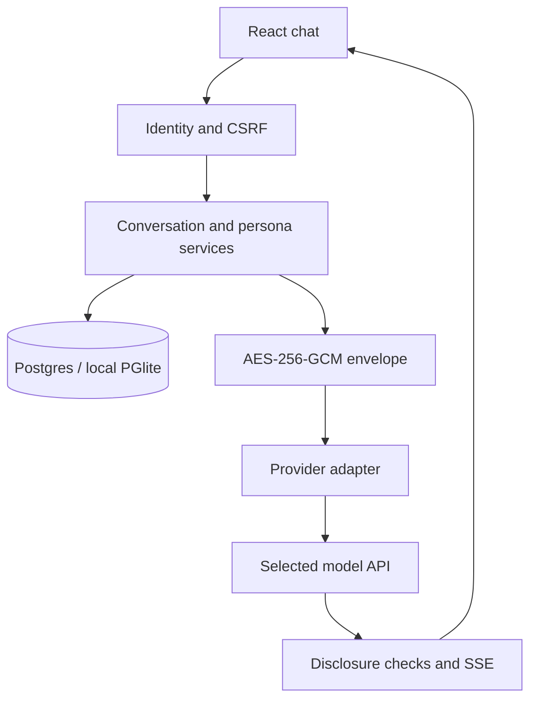

# Architecture

Harness is a Next.js App Router application with server-proxied model calls. A user chooses a connection, types a role and optional focus, and starts a conversation. Public APIs never return the generated persona definition or compiled system prompt.

## Modules and storage

`src/app/api/` contains bootstrap, connections, personas, conversations, chat, and Auth.js handlers. `src/lib/providers/` normalizes discovery, text/images, tool proposals, SSE, usage, cancellation, and errors. `src/lib/server/service.ts` enforces ownership and conversation behavior; explicit public serializers select safe fields. `persona.ts` owns role validation, structured compilation, system-prompt assembly, context budgets, and disclosure checks. Infrastructure modules provide encryption, auth, request validation, rate limits, and metadata-only logs.

The database schema is initialized idempotently using parameterized SQL. Postgres uses `postgres.js`; local development can use persistent PGlite (in-process PostgreSQL).

| Table                             | Responsibility                                                                               |
| --------------------------------- | -------------------------------------------------------------------------------------------- |
| `users`                           | Account identity and Auth.js user fields.                                                    |
| `provider_connections`            | Owner, provider/model metadata, last four key characters, authenticated ciphertext envelope. |
| `personas`                        | Private definition/prompt, role/focus, greeting, cache key, template version.                |
| `conversations`                   | Owner, persona, current connection/model, title, timestamps, soft deletion.                  |
| `messages`                        | Visible content, image attachments, completion status, timestamps.                           |
| `usage_logs`                      | Provider/model, tokens, latency, and status without content or credentials.                  |
| `accounts`, `verification_tokens` | OAuth account links and expiring email sign-in tokens.                                       |

Provider-key encryption is separate from message storage. Messages and persona definitions are not application-encrypted; production database encryption/access controls remain operator responsibilities. Preserve the master key separately from encrypted connection backups.

## Persona lifecycle

1. Validate role/focus and reject harmful or instruction-overriding labels.
2. Check account ownership, connection, and discovered model availability.
3. Look up the cache for user, normalized role/focus, provider, and template version.
4. Ask the user's model for a strict JSON definition: identity, expertise, reasoning, communication, teaching, honesty, boundaries, and greeting.
5. Validate and assemble the private prompt with fixed honesty/privacy rules and medical/legal/financial scope rules.
6. Persist server-side; return only id, role, focus, greeting, and color.
7. Inject the same stored prompt on every chat request through each provider's appropriate instruction field. Switching models changes the connection, not the persona.

Cache hits avoid another compilation call. New role compilation can incur provider charges. Context does not establish world-best expertise or professional qualifications.

## Streaming and history

The chat endpoint emits named SSE events: `text {text}`, `usage {inputTokens,outputTokens}`, `done {messageId,conversationId,truncatedTurns}`, and `error {code,message}`. Client cancellation propagates to provider fetch and backoff. An in-process conversation lock prevents overlapping sends/edits in one app process. Retries happen only before visible output. Failed/cancelled partial messages retain an explicit status.

Context budgeting uses a conservative UTF-8 estimate, not an exact provider tokenizer. Old complete turns are removed as needed while the persona and latest request remain. Actual usage comes from provider events. Images from earlier turns are marked unavailable after a switch to a text-only model; new unsupported images are rejected.

## Disclosure limits

Public serializers omit generated instructions. Direct extraction requests are refused before a provider call. A rolling guard retains a short suffix, detects known prompt substrings and an integrity marker across chunk boundaries, and stops literal disclosures before protected text is emitted. The compiler checks greetings too.

This cannot guarantee secrecy against arbitrary model paraphrase or transformation. No provider key or account secret is placed inside personas. Role filters and boundary instructions also cannot establish comprehensive safety or clinical correctness.

## Production boundaries

- Production requires Postgres, Redis, a base64 32-byte master key, an independent Auth.js secret, an exact application origin, and a configured sign-in provider. Missing core configuration fails closed.
- Explicit development identity is restricted to loopback requests and disabled in production. Test identity/provider overrides are unavailable in production.
- Mutations require matching Origin, JSON, a request guard header, validated input, and account ownership.
- Generic endpoints require approved HTTPS hosts/public DNS; redirects are forbidden. DNS checks are not connection-pinned. Restrict production outbound network access and approve only trusted domains.
- Logs allow only metadata fields. Usage records support per-provider latency/status analysis without keys or message text.
- Adapters normalize tool-call proposals; no external tool executor is enabled. Video Editor roles can provide plans/specifications, not silently edit a video.
- Horizontal scaling needs a distributed generation lock; the current generation lock is process-local. Redis backs rate limits; Auth.js uses signed JWT sessions.

Production is a Node server using raw TCP to Postgres/Redis. The retained legacy static Sites manifest does not deploy it. Cloudflare Workers/static hosting cannot run this configuration unchanged.
